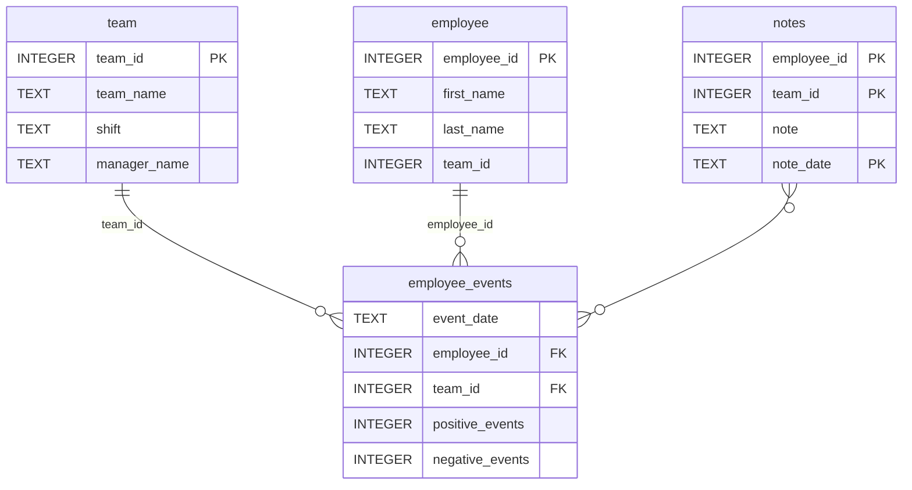

# Software Engineering for Data Scientists 

This repository contains starter code for the **Software Engineering for Data Scientists** final project. Please reference your course materials for documentation on this repository's structure and important files. Happy coding!

### Repository Structure
```
├── README.md
├── assets
│   ├── model.pkl
│   └── report.css
├── env
├── python-package
│   ├── employee_events
│   │   ├── __init__.py
│   │   ├── employee.py
│   │   ├── employee_events.db
│   │   ├── query_base.py
│   │   ├── sql_execution.py
│   │   └── team.py
│   ├── requirements.txt
│   ├── setup.py
├── report
│   ├── base_components
│   │   ├── __init__.py
│   │   ├── base_component.py
│   │   ├── data_table.py
│   │   ├── dropdown.py
│   │   ├── matplotlib_viz.py
│   │   └── radio.py
│   ├── combined_components
│   │   ├── __init__.py
│   │   ├── combined_component.py
│   │   └── form_group.py
│   ├── dashboard.py
│   └── utils.py
├── requirements.txt
├── start
├── tests
    └── test_employee_events.py
```

### employee_events.db




### Running the project dashboard using FastHTML
The project has a simple interactive employee and team events dashboard, which has been built using FastHTML.
These instructions may vary by Windows or Apple OS and by version.

Steps on how to run the dashboard locally:

1. Activate your project's virtual environment:
source .venv/Scripts/activate

2. Install the dependencies:
pip install -r requirements.txt

3. Start the dashboard: 
python report/dashboard.py 

4. Open your local URL shown in your terminal in your web browser:
For example, http://localhost:5001/employee/17